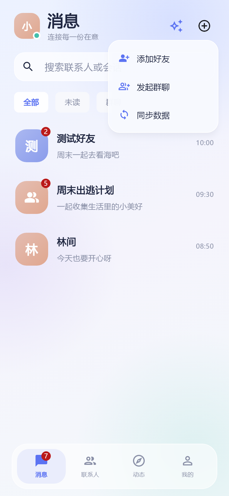
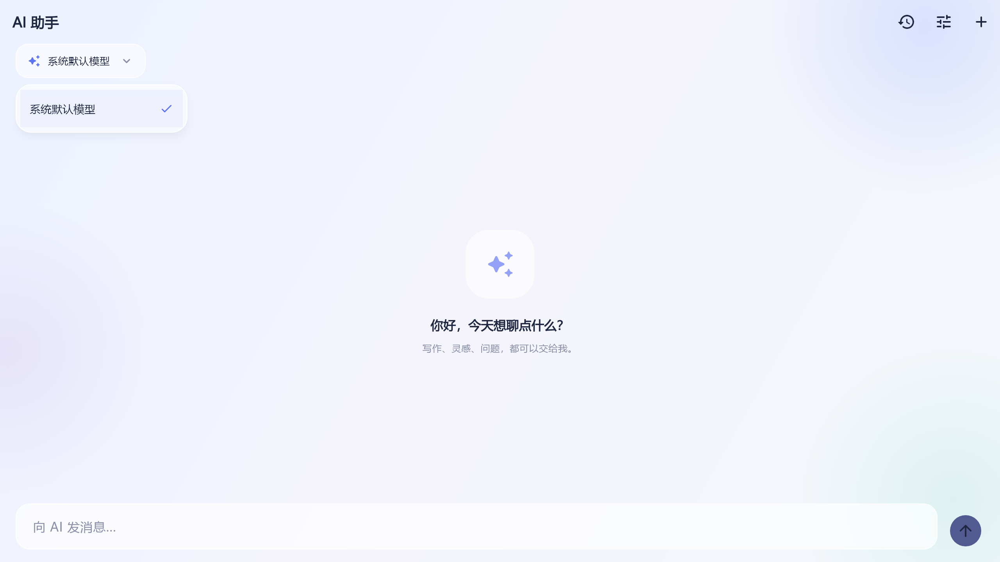

# 应用图标、弹层与热门动态修复

## 修改范围

仅修改 `im_app`。Electron 工程用于读取图标和接口约定，Java 工程用于核对返回结构和查询逻辑。本次没有启动 APK/桌面安装包构建，继续由用户自行打包。

## 应用图标

Electron 的 `electron-builder.yml` 明确使用 `build/favicon.ico` 作为 Windows 程序、安装器和卸载器图标。该文件与 `resources/icon.png` 是相同的双气泡标志，ICO 最大图层为 256×256。

- Windows：原 ICO 直接复制到 `windows/runner/resources/app_icon.ico`，SHA-256 校验与源文件完全一致，保留 16/32/48/64/128/256 各尺寸。
- Flutter 界面：提取最大图层为 `assets/branding/app_icon.png`，替换登录页和“关于”的临时图标。
- Android：替换所有密度的 launcher PNG，增加 Android 8+ adaptive icon 及中央安全区前景。
- iOS/macOS：按既有 AppIcon manifest 生成尺寸；iOS 输出不透明 RGB 图片。
- Web：替换 favicon、普通/PWA maskable 图标，并同步名称与主题色。

素材来源说明见 `assets/branding/README.md`，再生成脚本为 `tool/generate_app_icons.py`。未新增 pub 依赖。源图只有 256×256，1024 等更大尺寸通过重采样适配，未声称增加源图细节。

安装包图标属于原生资源，热重载不会更新已安装程序的图标；需要重新打包并安装。页面和弹层修改可通过热重启查看。

## 菜单与 AI 模型选择器

截图中显示的是 Flutter 默认 PopupMenu/Dropdown overlay，并非 CSS 缓存失效。此前页面的毛玻璃卡片不会自动设置独立 overlay 的背景、圆角与阴影。

- 在 `lib/ui/theme.dart` 统一 PopupMenu 的浅色半透明背景、20px 圆角、白色边线、柔和阴影和标签字体。
- 统一悬停、焦点和按压反馈为低透明度主题色。
- 首页菜单补充对应操作图标、统一间距，菜单宽度 188–230。
- AI 模型选择由整行 `DropdownButton(isExpanded: true)` 改为紧凑的玻璃按钮及带勾选标记的弹出菜单。按钮及菜单最大宽度均为 320，在桌面宽屏下保持紧凑；模型切换仍更新当前模型配置。

合成数据的 Flutter 测试渲染截图：





这些是布局验收图，未冒充真实用户的聊天数据或实际模型调用结果。

## 热门动态的原因

请求已经存在，地址是 `GET /moments/list/hot?page=1&pageSize=20`。后端 `MomentsController.listByHot` 返回 `Result<PageResult<MomentsVO>>`；实际结构为：

```json
{
  "code": 1,
  "data": {
    "total": 1,
    "data": [{ "id": "1792113130553123456", "content": "..." }]
  }
}
```

API 层已经解包最外层 `Result.data`，但旧 `asList` 只识别 `records/list/items`，没有读取 `PageResult.data`，导致有记录的响应被变成空列表。Java 的 `im-common/common-model/.../result/PageResult.java` 明确定义的字段就是 `total` 和 `data`；热门查询本身有 Redis 排行榜及数据库降级路径。

修复统一列表解析，并保留原始列表及 `records/list/items` 兼容。采用相同 Java 分页结构的“我的动态”、评论、回复和钱包账单也因此恢复正常读取。热门及个人动态同时根据 `total` 判断是否还有下一页，最新动态继续使用 ID 游标。

没有通过切换为“最新”请求或填充假数据来替代热门数据。本次未为联调重新登录真实账号，也没有修改后端热榜或业务数据。

## 验证

- 全量 Flutter 测试 25 项通过（包含可选视觉导出）。新增覆盖 Result→PageResult 真实字段结构、ID 字符串保留、热门请求参数及前后两页渲染/分页终止、桌面模型按钮/菜单最大宽度与切换行为。
- 静态分析无问题；`git diff --check` 通过。
- 37 张生成的 PNG 完成图片解码校验；15 张 iOS AppIcon 全部为 RGB；Android adaptive 前景最高密度为 432×432；Windows ICO 与 Electron 源文件哈希相同。
- 检查首页菜单与 1280px 桌面 AI 模型菜单的实际 Flutter 渲染截图。视觉测试启用了正常阴影绘制，避免测试环境用阴影轮廓代替实际模糊。
- 原生安装后的图标外观需要重新打包安装验收；本次没有执行发布或打包操作。
