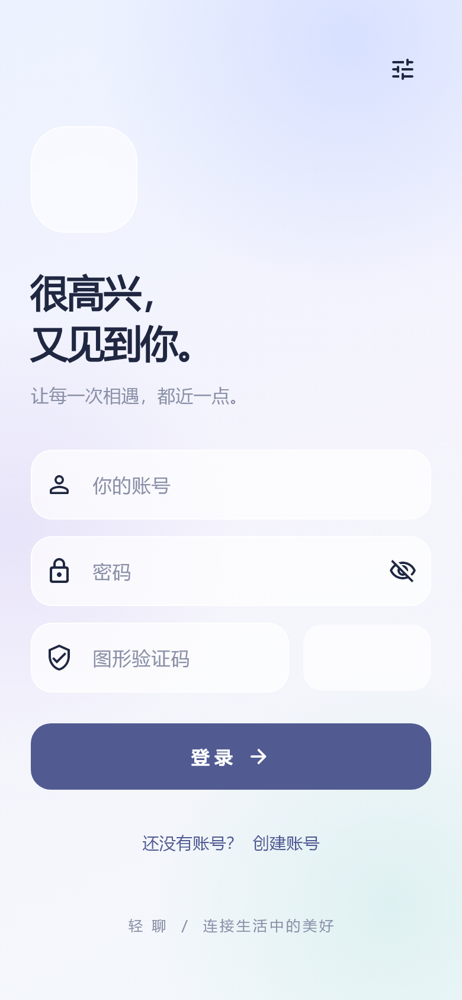
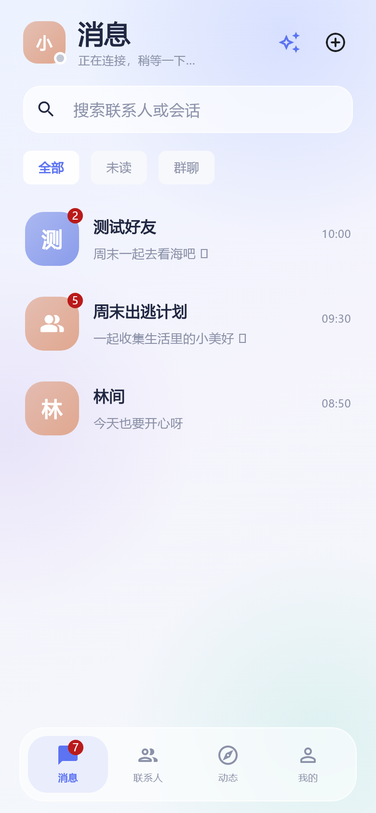
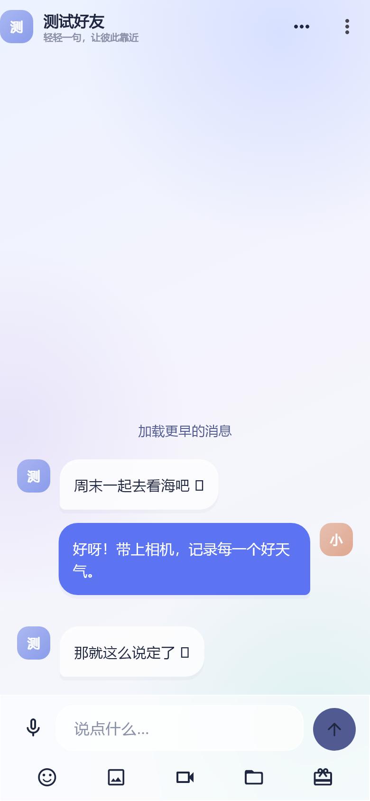
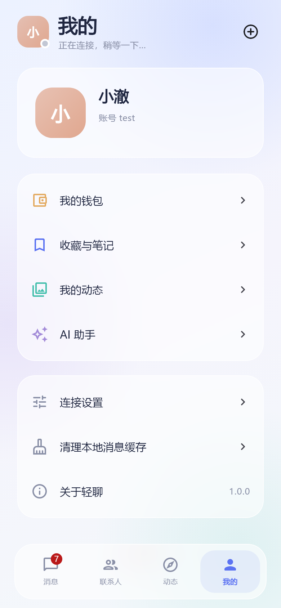

# 轻聊 Flutter 客户端

更新时间：2026-10-26。实现范围以工作区 Electron 客户端和 Java 服务源码为依据；后端及 Electron 工程保持原样。

## 启动

在 `im_app` 根目录运行：

```powershell
.\tool\flutter.ps1 pub get
.\tool\flutter.ps1 analyze
.\tool\flutter.ps1 test --no-pub
.\tool\flutter.ps1 run
```

`tool/flutter.ps1` 读取 `android/local.properties` 中的 Flutter SDK；补全当前工具进程缺失的 Windows 环境变量，识别本机 Android SDK/Gradle 缓存，并配置本次命令使用的依赖源。它不会修改系统环境变量、代理、注册表或重置网络。

Android 默认 HTTP 地址 `http://10.0.2.2:81`、WS 地址 `ws://10.0.2.2/ws`，适用于模拟器访问电脑；Windows/macOS/Linux/iOS 模拟器及 Web 默认使用 `127.0.0.1`。已保存的自定义设置优先。登录页右上角可以更改地址，或点“使用当前平台默认地址”再保存；真机请填写电脑局域网 IP，并确保电脑防火墙及后端监听允许访问。服务返回的头像、文件地址也必须能从手机访问。

可在构建时覆盖默认地址：

```powershell
.\tool\flutter.ps1 run --dart-define=API_BASE_URL=http://192.168.1.10:81 --dart-define=WS_BASE_URL=ws://192.168.1.10/ws
.\tool\flutter.ps1 build apk --debug --no-pub
.\tool\flutter.ps1 build web --no-pub
```

Android 开发包沿用模板的应用 ID 和调试签名。由于现有服务使用 HTTP/WS，Android 已允许明文连接，iOS 已配置 ATS 开发例外。正式发布时应配合 HTTPS/WSS、正式签名和应用 ID 收紧配置。

## 文件组织

| 位置 | 职责 |
| --- | --- |
| `lib/main.dart` | Flutter 初始化、系统栏、偏好读取 |
| `lib/app.dart` | 应用入口、中文本地化、登录切换、生命周期 |
| `lib/core/api_client.dart` | HTTP、网关 Token 分流、响应解包、并发刷新、SSE 解析 |
| `lib/core/im_protocol.dart` | 与 Netty 一致的 16 字节二进制协议 |
| `lib/core/im_socket.dart` | 单连接、心跳、递增延迟重连、过期连接隔离 |
| `lib/core/app_state.dart` | 账号生命周期、会话与好友、消息合并、ACK、未读数、缓存 |
| `lib/core/file_service.dart` | 文件分类、MD5、5 MiB 分片、断点查询、合并、消息通知 |
| `lib/core/session_storage.dart` | 系统安全存储中的凭据；服务地址和账号隔离的有限消息缓存 |
| `lib/features/auth` | 登录、验证码、注册 |
| `lib/features/home` | 底部导航、消息搜索与分组 |
| `lib/features/chat` | 聊天输入、消息气泡、引用、撤回、媒体预览、聊天记录搜索 |
| `lib/features/contacts` | 好友资料、申请、建群、邀请、群管理 |
| `lib/features/moments` | 最新/热门动态、发布编辑、评论回复、点赞与打赏 |
| `lib/features/profile` | 个人入口、服务器设置、收藏、笔记 |
| `lib/features/wallet` | 钱包、充值提现、账单、收发红包 |
| `lib/features/ai` | AI 历史会话、SSE 对话、模型配置 |
| `lib/ui` | 统一主题、毛玻璃背景/卡片、头像、空状态、异步加载组件 |

状态层使用 Flutter 自带的 ChangeNotifier/InheritedNotifier。页面组件按业务目录拆分，协议和网络处理不散落到页面。后台任务退出时取消录音、上传和流式请求；凭据不进入普通偏好或日志。每个会话最多缓存最近 150 条，较早记录通过服务器分页加载。

## 已接入的功能

| 模块 | 实现 |
| --- | --- |
| 登录注册 | 原有账号密码登录、图形验证码、头像 multipart 注册、手机验证码、响应头 Token、恢复登录、退出 |
| 消息 | 私聊/群聊、在线状态、ACK、失败重发、去重、未读数、置顶/免打扰、引用/撤回、表情、历史分页、已加载记录搜索、清空 |
| 媒体 | 图片选择与放大、视频选择与播放、文件上传和保存、录音与语音播放、上传进度和取消；单文件限 50 MB |
| 联系人 | 搜索账号/手机号、发送/处理好友申请、备注、黑名单、删除好友、发起聊天 |
| 群聊 | 默认或自选头像建群、邀请与处理邀请、群资料、成员展示、群名/描述、邀请成员、管理员、禁言、移出成员、群主转让、退出/解散 |
| 动态 | 最新/热门、我的动态、图文发布/编辑/删除、点赞、评论、回复、评论点赞、打赏 |
| 收藏笔记 | 消息收藏、收藏列表/删除、文本及 HTML 内容、图片、笔记新建/编辑/插图 |
| 钱包 | 余额/冻结金额、充值/提现、分类分页账单、普通/拼手气红包、领取及领取记录 |
| AI | 系统默认/自定义模型、模型配置增删改/默认切换、会话历史/重命名/删除、新会话、Markdown、思考内容、SSE 增量、停止生成 |

已有图文内容保留 HTML 格式。当前移动端编辑器提供文本输入和插图；编辑已有富文本时以 HTML 保留并允许修改，没有复制桌面端完整 Tiptap 工具栏。

## 对接时确认的约定

1. Java 的业务响应成功标志为 `code=1`，业务数据在 `data`；AI 服务同时兼容直接返回 JSON 数据。
2. 登录和刷新响应头为 `Authorization: Bearer ...` 和 `refreshtoken`。客户端存储时去掉 Bearer，请求时遵循原项目直接传 Token。
3. 网关 `auth.refreshPaths` 中的 `/conversation/init/list`、`/friend/init/list`、`/message/init/list/**`、`/message/verifyUploadToken/**`、`/message/merge` 使用 RefreshToken，其余普通业务使用 AccessToken；401 共享一次刷新任务并至多重放一次。跨账号旧响应不会覆盖新账号 Token。
4. 源码中的真实好友/会话列表入口是 `/init/list?isInit=true`；部分 Electron renderer API 中的 `/list` 与后端不一致，因此没有照搬不存在的接口。
5. 私聊 ID 为“较大用户 ID_较小用户 ID”，没有 `p_` 前缀。好友申请通过时后端已经插入会话，打开隐藏会话时不重复 INSERT。后端会话 `status=1` 表示显示。
6. ID 在客户端统一保留字符串，通过 JSON 字符串兼容 Java Long 参数，避免 Web 的 JavaScript Number 精度损失。
7. WS 帧：魔数 `[1,2,3,4]`、版本 1、JSON 序列化 0、类型 1B、序列 4B、大端、填充 255、长度 4B、UTF-8 正文。私聊请求 1、群聊请求 3、系统请求 12，响应 2/4/13、ACK 16。ACK 的 `status=0` 才表示成功，界面消息 `sendStatus=1` 表示已发送。
8. 文件先取凭证、查询已传分片、5 MiB 分片 MD5 校验和合并，然后预存消息并发送 WS 通知；HTTP 与 WS 共用一个消息 ID。
9. 建群必须上传 `groupAvatar`，群邀请处理必须提交 `groupAvatarBlob`；无自选图片时用代码生成默认群头像。群邀请 `status=1/2/3` 分别表示待处理/接受/拒绝，好友申请 `dealResult=1` 表示接受。
10. AI 网关实际路由到 `im-agent`，采用 Electron 当前的 `/ai-message/...` 和命名 SSE 事件约定，不接已被路由替代的旧 Java AI 实现。

## 验证证据

### 真实后端

使用用户提供的专用测试账号完成了：验证码读取、真实登录、双 Token 响应头、Token 刷新、1 个会话、1 位好友、49 条历史消息、WebSocket 握手、二进制在线列表、心跳，以及朋友圈/收藏/钱包/AI 历史/模型配置的真实读取。

联调脚本是 `tool/smoke_backend.dart`，从 `IM_TEST_ACCOUNT` 和 `IM_TEST_PASSWORD` 临时环境变量读取凭据。项目没有保存测试密码、Token 或真实消息内容。脚本只输出检查结果和数量，不打印用户资料。

没有向测试账号的真实好友发送消息，没有执行真实充值、提现、打赏、红包或删除操作。这些写操作的实际效果仍需双账号/真机验收。

### 自动化

`test/` 覆盖：网关凭据分流、并发 401 合并刷新、刷新失效停止、跨账号旧响应隔离、二进制大端/中文/Emoji/Long ID、畸形帧、跨字节 SSE/CRLF/截断、金额精度与非法金额、消息去重与 ACK、隐藏会话重用、缓存隔离、文件断点续传与消息 ID 一致性、红包确认及消息 ID 一致性、登录表单和服务器设置、320 像素窄屏导航和聊天输入。

验证码修复后的全量执行结果：20 项通过、1 项可选截图导出跳过；静态检查无问题。可选截图已单独执行通过并完成人工查看。

可选视觉导出：

```powershell
$env:CAPTURE_UI='1'
.\tool\flutter.ps1 test --no-pub test/visual_capture_test.dart
```

截图位于 `build/visual/`，交付快照位于本目录 `screenshots/`。它们来自 Flutter 测试渲染及合成数据，用于版面检查，不能作为真机媒体播放、语音权限或真实写入成功的证明。

| 登录 | 消息 | 聊天 | 我的 |
| --- | --- | --- | --- |
|  |  |  |  |

### 平台

- Web release 构建已经通过。主要交付目标仍为 Android/iOS，Web 构建用于补充编译验证。
- Android 构建依赖已补充 NDK 28.2.13676358，但最近一次构建被本项目另一个 Gradle 进程持有的 `buildLogic.lock` 阻挡，尚未产出可交付 APK；未停止无法确认归属的构建进程。
- 本机只有 Windows，iOS 的 Xcode、签名和真机权限没有验证。
- 现有 Android AVD 启动报错：`Android Emulator hypervisor driver is not installed on this machine`；未修改系统虚拟化配置。
- 当前会话内置浏览器不可用，视觉检查通过 Flutter 原生测试渲染完成，未声称完成浏览器实际点击验收。

## 依赖与环境问题的解决方式

1. **socket/Winsock 10106**：工具终端缺少 `SystemRoot`、`windir`、`ComSpec`。补齐当前进程后，相同镜像请求从 socket 错误恢复为 HTTP 200，随后 `pub get` 成功，无需重置 Winsock。
2. **清华镜像**：Dart 包源使用 `https://mirrors.tuna.tsinghua.edu.cn/dart-pub/`。本机 Flutter master 引擎在清华资源镜像返回 404，改用官方 `https://storage.googleapis.com` 下载同一版本引擎。
3. **代理接管本机 WebSocket**：为当前命令设置 `NO_PROXY/no_proxy=localhost,127.0.0.1,::1,10.0.2.2`，解决 Flutter 测试 VM 和本地 WS 的 `Invalid WebSocket upgrade request`。Gradle 需要的 HTTP 代理从已有 `HTTPS_PROXY` 读取，仅用于当前进程。
4. **Flutter 3.50 master UI 拆包**：沿用原工程的 `material_ui` 包，并使用其本地化委托。修复毛玻璃卡片内 ListTile 缺少 Material 绘制层的问题。
5. **HTML 依赖内部 API 不兼容**：原选 `flutter_html 3.0.0` 调用了新版 html 已不存在的内部函数 `matches`。替换为 `flutter_widget_from_html_core`，保留图文和链接预览，Web 编译通过。
6. **Gradle**：使用本机已有的 `E:\Gradle` 缓存，wrapper 使用相同 9.5.0 的 bin 包。被中断构建遗留的本项目 Gradle 进程已定向清理，没有停止其他 Java 服务。
7. **NDK 与新版 Android CLI**：Flutter 自动调用旧参数 `sdkmanager --install ndk;28.2.13676358` 被本机新版 CLI 拆成两个包名。按 CLI 列表改用 `android --no-metrics --sdk=E:/Android/Sdk sdk install ndk/28.2.13676358`，成功安装所需 NDK，没有降低 Flutter/AGP/NDK 版本。

## 明确边界

- 保持现有登录/单端 Token 策略，没有添加 deviceId、设备互踢或多端会话后端逻辑。
- Electron 工作区工具访问的是电脑本地文件系统，移动端没有直接访问电脑目录的能力。AI 请求不声明电脑工作区；若服务仍请求本地工具，会返回明确失败，避免无限等待。
- 桌面端存在 `/user/updateInfo` 调用，但当前 Java UserController 没有对应实现；移动端展示个人资料，没有本地伪造资料修改成功。
- Electron 专用的托盘、独立聊天窗口、全局快捷键和桌面存储位置不适用于手机。
- 系统级后台离线推送、来电/音视频通话不在现有后端接口中；当前实时消息依赖前台 WS，返回前台后重新同步。
- 录音、文件选择保存、视频和音频播放涉及平台插件，必须在真机补充权限与媒体格式验收。大文件内存占用通过 50 MB 上限控制，尚未实现流式大文件、上传暂停恢复 UI。
- HTML 编辑器尚未包含桌面端所有富文本样式按钮；评论主列表和账单支持分页，单条评论回复弹层目前一次读取最多 100 条。
- 当前是开发交付，不能把协议测试、合成截图和接口读取视为所有业务完成端到端验收。

## 验证码加载失败修复

用户测试反馈验证码加载失败后，复核得到：本机 `127.0.0.1:81/user/verifyCode` 返回 HTTP 200、`image/jpeg`、2317 字节；同机访问 `10.0.2.2:81` 连接失败。原实现把 Android 模拟器地址用于所有平台，导致桌面测试请求错误的目标。

已修改为按平台选择默认 HTTP/WS 地址，保留用户手动保存的设置。连接设置新增默认地址恢复入口；验证码展示增加加载状态、错误原因、当前接口、重试与连接设置按钮。异步请求按序号隔离，旧服务器请求不会覆盖新设置返回的验证码；接口返回 HTML/JSON 或空内容时明确报错，图片解码失败也有对应展示。

增加回归覆盖桌面/Android 默认地址、保留自定义地址、接受验证码图片及拒绝错误 HTML 响应。更新后需要热重启应用；若已经保存了旧地址，应在连接设置恢复当前平台默认值并保存。
